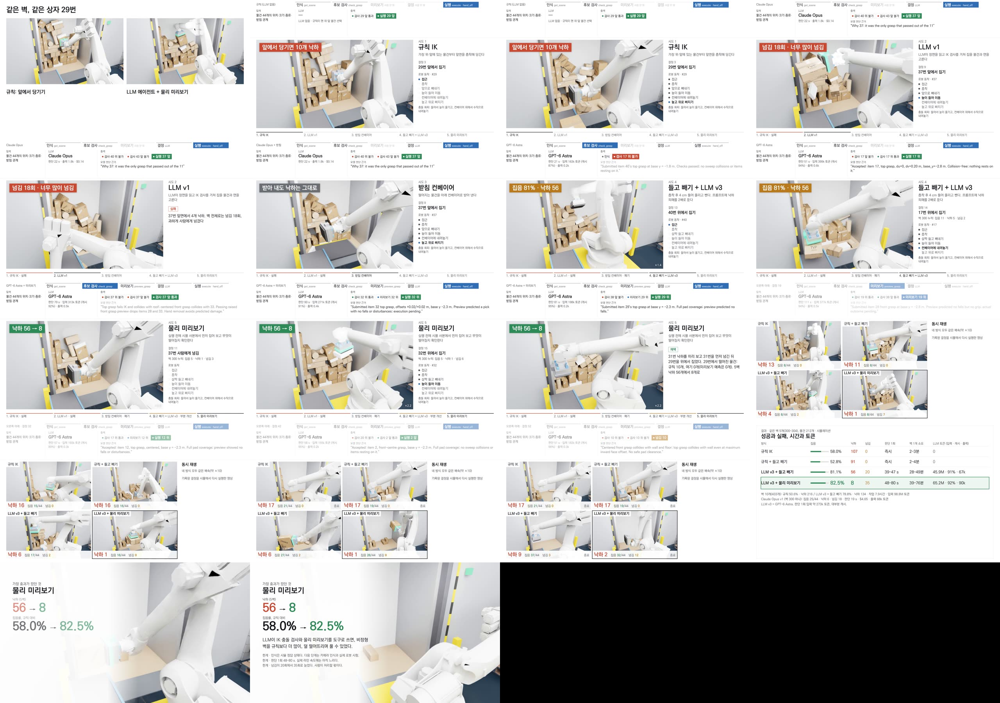

# LLM as a pick decider for irregular truck unloading (Isaac Sim)

A KR210 with a suction pad unloads messy box walls (mixed sizes, boxes leaning on each other).
The LLM does not move joints. It chooses the next box through MCP tools and can hand a box off to a person.



## Result (simulation only)

Same 5 walls, 212 items:

| Decider | Picked | Fell | Hand-offs |
|---|---|---|---|
| Rule ("top-front first") | 123 (58.0%) | 107 | 0 |
| LLM (GPT-6 Astra) | 172 (81.1%) | 56 | 20 |
| LLM + physics preview tool | 175 (82.5%) | 8 | 35 |

- Claude Opus on wall 1 handed 18 of 44 boxes to a person (too conservative).
- Closed-loop rule baselines and VLA/VLM baselines (SmolVLA, Qwen3-VL-8B) are in `data/cl_compare.json`.

Limits: simulation only, perception uses simulator ground truth (no camera yet), 38–80 s per LLM decision. Not tested on a real robot.

## MCP tools given to the LLM

1. Read the wall: boxes, poses, support graph (what rests on what).
2. Check a grasp: IK reachability, pad collision, suction coverage.
3. Preview: run the grasp on a physics copy of the scene, report what falls, roll back.
4. Execute, or hand off to a person.

## Layout

- `sim/` Isaac Sim scripts (`u1_sim_cl.py` closed-loop sim and replay, `u1_mcp.py` tools, `u1_rule.py`, `u1_walls*.py`) and PowerShell run scripts.
- `data/` walls, plans, per-run results, LLM tool I/O logs (`agent_io`), summaries.
- `video/` Remotion 4 project for the KO/EN explainer video (`Main-ko`, `Main-en`).
- `media/` stills from the video.

## Running

Requires a local Isaac Sim install (its `python.bat`) and Windows PowerShell.

```powershell
# replay a logged run and render frames
& sim\run_vid6.ps1
# build video data and render
python sim\_vid_data.py
cd video; npm ci; .\render4.cmd
```

Fonts and the rendered sim clips are not committed (see `video/public/README.md`).
Paths in the scripts are relative to the script folder; set your Isaac Sim path in the `run_*.ps1` files.

